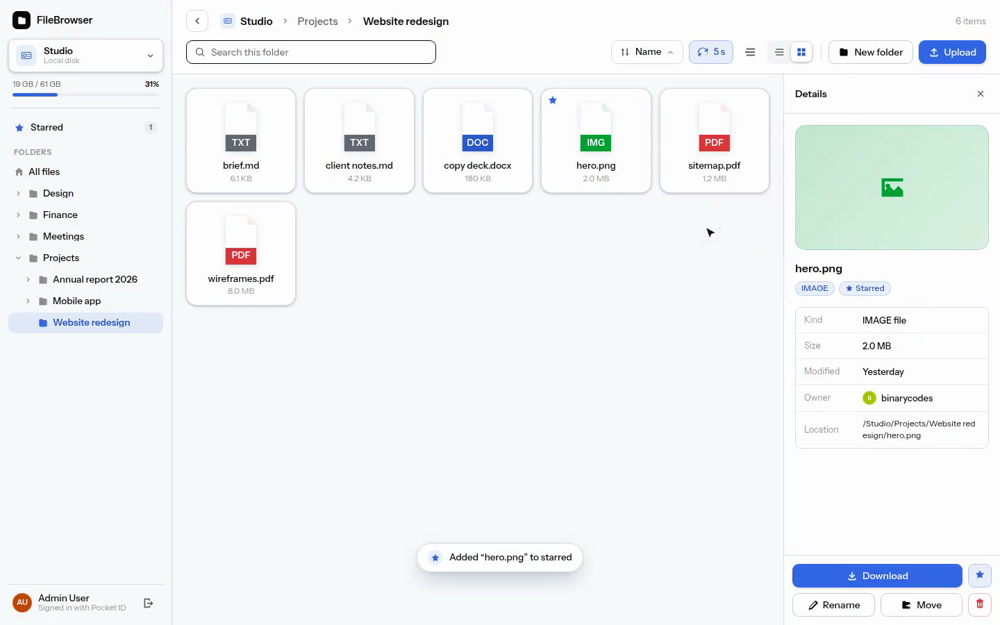

# FileBrowser

A web file browser for folders on the server: local disks and NFS/SMB shares the OS has mounted.
Sign-in is through your own OIDC provider, and admins choose which folders everyone can browse.

[](media/demo.mp4)

*Click the image to watch the demo video.*

## Deploy

`environment/prod/` has a sample `docker-compose.yml` that runs the published image with one OIDC
provider, a volume for the database and one host folder to add as a file system. Copy
`.env.example` to `.env` next to it and fill it in. Create the secret key file next to it too (it
encrypts stored S3 keys; keep it, and make it readable by the container's user, uid 10001):

```bash
openssl rand -base64 32 > environment/prod/secret-key
```

Then start it:

```bash
docker compose -f environment/prod/docker-compose.yml up -d
```

## Sign-in

Sign-in is OIDC only: the app has no passwords or accounts of its own and identifies users by the
`email` claim, whichever provider they come from. With one provider configured, sign-in goes
straight to it; with several, a chooser shows one button per provider.

### Configuration

Providers use Spring's standard client registration properties; `<ID>` is any name you pick.

| Variable | Purpose |
| --- | --- |
| `SPRING_SECURITY_OAUTH2_CLIENT_REGISTRATION_<ID>_CLIENT_ID` | Client id at the provider |
| `SPRING_SECURITY_OAUTH2_CLIENT_REGISTRATION_<ID>_CLIENT_SECRET` | Client secret |
| `SPRING_SECURITY_OAUTH2_CLIENT_REGISTRATION_<ID>_SCOPE` | `openid,email,profile` |
| `SPRING_SECURITY_OAUTH2_CLIENT_PROVIDER_<ID>_ISSUER_URI` | Issuer URL (its `/.well-known/openid-configuration` must be reachable at startup) |
| `FILEBROWSER_OIDC_<ID>_LABEL` | Button text: "Continue with <label>" |
| `FILEBROWSER_OIDC_<ID>_ICON` | `google`, `keycloak`, `pocket-id` or `generic` |
| `FILEBROWSER_ADMIN_EMAILS` | Comma-separated emails that are admins (may add, edit and remove file systems) |
| `FILEBROWSER_ALLOWED_DOMAINS` | Optional; if set, the email's domain must be one of these |
| `FILEBROWSER_ALLOWED_EMAILS` | Optional; if set, the email must be one of these (checked after domains) |
| `FILEBROWSER_REQUIRE_VERIFIED_EMAIL` | Default `true`: refuse sign-ins whose `email_verified` claim is `false` |

Register the app at each provider with the redirect URI `<app-url>/login/oauth2/code/<ID>` and the
post-logout redirect URI `<app-url>`. Signing out also ends the provider session when the provider
advertises an `end_session_endpoint`.

## Data

Application data (file systems, user accounts, starred items, view settings) lives in one SQLite
file, `./data/filebrowser.db` by default; set `FILEBROWSER_DATABASE_PATH` to move it. Flyway creates
and upgrades the schema at startup. Files themselves stay where they are on disk.

Backup: copy the file while the app is stopped, or take a consistent copy while it runs:

```bash
sqlite3 data/filebrowser.db "VACUUM INTO 'backup.db'"
```

Restore: stop the app and put the copy in place.

## File systems

Admins add file systems from the app; everyone sees all of them. A file system is a folder on the
server: a local disk, or an NFS/SMB share the OS has mounted. The app detects which (from the mount
type), shows the real capacity, and marks a file system offline when it can't be read in time. Any
absolute path the server process can read may be added; it is added read-only when the server can't
write to it.

A file system can also be an S3 bucket, or a folder in one (`s3://bucket` or `s3://bucket/folder`),
on AWS or any S3-compatible store (give its endpoint URL). Enter an access key ID and secret access
key, or leave both blank for a public bucket; the server's own AWS credentials are never used. Keys
are stored encrypted (AES-256-GCM, each bound to its file system) with a key read from the file
named by `FILEBROWSER_SECRET_KEY_FILE`, e.g. a Docker or Kubernetes secret holding 32 random bytes
in base64 (`openssl rand -base64 32`). The key is never taken from an environment variable. It must
be set to add buckets with keys and must stay the same afterwards. Moving or renaming a folder in a bucket copies and then deletes every object in it.

Admins can rename a file system or change its access from the "⋯" menu on its card; its path can't
change, so to point it elsewhere remove it and add it again. Removing a file system only takes it
off the list: its files stay on the disk, and everyone's stars in it are removed. Changes apply at
once, including for people who have it open.

Deleting files and folders in the app is permanent. Uploads are streamed straight into the folder
and appear only when complete; the limit per file is `FILEBROWSER_MAX_UPLOAD_SIZE` (default
`5GB`). Downloading a folder or several items produces a zip built on the fly.

Each user's starred items and view settings are saved per email. Renaming, moving or deleting an
item in the app updates everyone's stars; stars on items removed outside the app disappear the next
time they're looked up.

## Contributing

Running the app locally, the development sign-in providers, test shares and the code layout are in
[CONTRIBUTING.md](CONTRIBUTING.md).

## License

FileBrowser is free software: you can redistribute it and/or modify it under the terms of the GNU
General Public License as published by the Free Software Foundation, either version 3 of the
License, or (at your option) any later version. See [`LICENSE`](LICENSE) for the full text.
